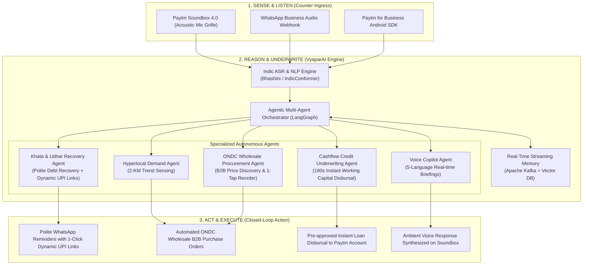

# 🚀 Paytm VyaparAI — The Autonomous AI Business Partner for Bharat Merchants

[](https://fastapi.tiangolo.com)
[](https://python.org)
[](https://paytm.com)
[](#-multilingual-voice-matrix)
[](https://opensource.org/licenses/MIT)

> **Paytm VyaparAI** transforms India's iconic **Paytm Soundbox** and **POS terminal** from passive payment announcers into an **autonomous 24/7 business copilot** for 40 million neighborhood merchants across Bharat.

---

## 📌 Table of Contents
- [Executive Overview](#-executive-overview)
- [System Architecture](#-system-architecture)
- [Autonomous Agents Breakdown](#-autonomous-agents-breakdown)
- [Multilingual Voice Matrix](#-multilingual-voice-matrix)
- [Key Features & Capabilities](#-key-features--capabilities)
- [Tech Stack](#-tech-stack)
- [Installation & Quick Start](#-installation--quick-start)
- [REST API Reference](#-rest-api-reference)
- [Pitch Deck & Submission Assets](#-pitch-deck--submission-assets)

---

## 🎯 Executive Overview

For 40M+ kirana stores, chemists, and MSMEs across India, payments are just the finish line. The merchant's daily struggle lies in **dead working capital (25-30% locked in slow inventory)**, **uncollected udhar (₹1.5L–₹3L trapped in paper khatas)**, and **isolation from hyperlocal demand trends**.

Existing SaaS apps demand barcodes, manual catalog entries, and English dashboards. **Paytm VyaparAI** eliminates all typing and screen friction by bringing **ambient voice intelligence** in **5 Indian languages** right to the merchant's counter.

---

## 🏗️ System Architecture



---

## 🤖 Autonomous Agents Breakdown

### 1. 🎙️ Voice Copilot Agent (`voice_copilot_agent`)
* **Role:** Hands-free merchant interface operating through the Soundbox and WhatsApp voice notes.
* **Capabilities:**
  * Delivers morning operational briefings: *"Aaj ka collection kitna hua?"* / *"ఈరోజు కలెక్షన్ ఎంత?"*.
  * Identifies top-selling SKUs and warns about low inventory before evening rushes.
  * Transcribes spoken dialect notes into structured ledger items with zero manual typing.

### 2. 📒 Smart Khata & Udhar Recovery Agent (`khata_recovery_agent`)
* **Role:** Recovers trapped credit while maintaining neighborhood goodwill.
* **Capabilities:**
  * Tracks credit age, outstanding balances, and purchase notes per customer.
  * Autonomously drafts culturally respectful, polite reminder notes in the customer's native language.
  * Embeds **dynamic 1-click UPI deep links** (`upi://pay?pa=guptakirana@paytm&am=3420&tn=Khata%20Clearance`) allowing customers to pay directly from WhatsApp in seconds.

### 3. 📡 Hyper-Local Demand Agent (`hyperlocal_demand_agent`)
* **Role:** Eliminates blindspots and levels the playing field against quick-commerce apps.
* **Capabilities:**
  * Analyzes anonymized transaction velocities across a 2-km radius.
  * Detects demand triggers: weather shifts (e.g. heatwave = +44% cold drinks surge), seasonal festivals, and local footfall.
  * Flags stagnant inventory (e.g. items with 0 sales in 14 days) and recommends bundling promotions.

### 4. 🛒 ONDC Wholesale Procurement Agent (`ondc_procurement_agent`)
* **Role:** Closes the gap between inventory insight and restocking.
* **Capabilities:**
  * Queries regional distributors listed on the Open Network for Digital Commerce (ONDC).
  * Automatically compares wholesale prices and delivery ETAs.
  * Drafts purchase orders and settles invoices directly from the merchant's Paytm balance with single-tap approval.

### 5. ⚡ Cashflow Credit Underwriting Agent (`credit_underwriting_agent`)
* **Role:** Eliminates loan paperwork and collateral requirements for MSMEs.
* **Capabilities:**
  * Continuously scores verified, second-by-second UPI settlement velocity.
  * Pre-approves ₹25,000 to ₹2,50,000 working capital credit based on cashflow consistency rather than balance sheets.
  * Enables **1-click disbursal in under 180 seconds** with automated micro-deductions (EDI).

---

## 🗣️ Multilingual Voice Matrix

Paytm VyaparAI natively understands and responds in 5 major Indian languages:

| Language | Audio Code | Sample Merchant Voice Query | Sample Agent Response |
| :--- | :---: | :--- | :--- |
| **English** | `en-IN` | *"How much is today's total collection and fast-selling item?"* | *"Boss, today's total collection reached ₹18,420 across 64 transactions..."* |
| **Telugu (తెలుగు)** | `te-IN` | *"ఈరోజు మొత్తం కలెక్షన్ ఎంత మరియు ఫాస్ట్ సెల్లింగ్ ఐటమ్ ఏది?"* | *"సేత్ గారూ, ఈరోజు సాయంత్రం 7 గంటల వరకు మొత్తం ₹18,420 కలెక్షన్ వచ్చింది..."* |
| **Hindi (हिंदी)** | `hi-IN` | *"आज का कुल मुनाफा और सबसे तेज़ बिकने वाला आइटम बताओ"* | *"सेठ जी, आज शाम 7 बजे तक कुल ₹18,420 का कलेक्शन हुआ है..."* |
| **Tamil (தமிழ்)** | `ta-IN` | *"இன்று மாலை வரை மொத்த வசூல் எவ்வளவு மற்றும் அதிகம் விற்ற பொருள் எது?"* | *"சேத் அவர்களே, இன்று மாலை 7 மணி வரை மொத்தம் ₹18,420 வசூலாகியுள்ளது..."* |
| **Kannada (ಕನ್ನಡ)** | `kn-IN` | *"ಇಂದಿನ ಒಟ್ಟು ಕಲೆಕ್ಷನ್ ಎಷ್ಟು ಮತ್ತು ಅತಿ ಹೆಚ್ಚು ಮಾರಾಟವಾದ ವಸ್ತು ಯಾವುದು?"* | *"ಸೇಠ್ ಅವರೇ, ಇಂದು ಸಂಜೆ 7 ಗಂಟೆಯವರೆಗೆ ಒಟ್ಟು ₹18,420 ಕಲೆಕ್ಷನ್ ಆಗಿದೆ..."* |

---

## 💻 Tech Stack

- **Backend Framework:** FastAPI (Python 3.10+) & Uvicorn async ASGI server.
- **Agentic Logic:** LangGraph multi-agent orchestrator with deterministic guardrails.
- **Speech & NLP Engine:** Bhashini ASR, IndicConformer, and Coqui TTS.
- **Data & Streaming:** Apache Kafka event streams, Vector embeddings (Milvus / Qdrant), TimescaleDB.
- **Protocols & Integrations:** ONDC B2B open commerce protocol, Paytm Payments Bank & Lending APIs, WhatsApp Cloud API.
- **Frontend & Simulator:** HTML5, Tailwind CSS, Chart.js, Web Speech API (speech recognition & speech synthesis).

---

## ⚡ Installation & Quick Start

### 1. Clone the Repository
```bash
git clone https://github.com/shaikjafar559/Paytm-VyaparAI.git
cd Paytm-VyaparAI
```

### 2. Install Dependencies
```bash
pip install fastapi uvicorn requests python-docx reportlab python-pptx
```

### 3. Launch the Server & Dashboard
```bash
python app.py
```
Open **[http://127.0.0.1:8000](http://127.0.0.1:8000)** in your browser.

### 4. Or Run in Terminal CLI Mode
```bash
python cli.py
```

---

## 📡 REST API Reference

| Method | Endpoint | Description |
| :--- | :--- | :--- |
| `POST` | `/api/copilot/query` | Process natural language voice/text query in English, Telugu, Hindi, Tamil, or Kannada. |
| `GET` | `/api/inventory` | Retrieve stock levels, low-stock warnings, and reorder thresholds. |
| `GET` | `/api/khata` | Fetch pending customer udhar ledger and debt aging. |
| `POST` | `/api/khata/remind` | Autonomously generate polite WhatsApp reminder with dynamic 1-click UPI payment link. |
| `GET` | `/api/demand` | Get 2-km radius neighborhood transaction demand radar. |
| `POST` | `/api/ondc/order` | Execute 1-click B2B wholesale reorder from lowest-priced distributor. |
| `GET` | `/api/credit/evaluate` | Evaluate transaction velocity and retrieve instant pre-approved credit report. |

---

## 📁 Repository Structure

```
Paytm-VyaparAI/
├── app.py                             # FastAPI production server & REST API
├── copilot_engine.py                  # Core Autonomous Multi-Agent Engine
├── cli.py                             # Interactive Terminal CLI tool
├── index.html                         # Interactive Web Dashboard & Soundbox Simulator
├── generate_deck.py                   # Script generating Widescreen PowerPoint Presentation
├── generate_pdf.py                    # Script generating Presentation PDF
├── generate_docx.py                   # Script generating Executive Pitch Document
├── Paytm_VyaparAI_Pitch_Deck.pdf      # Presentation Deck PDF (<2MB submission ready)
├── Paytm_VyaparAI_Pitch_Deck.pptx     # 16:9 Widescreen PowerPoint Presentation
├── Paytm_VyaparAI_Pitch_Document.docx # Formal Word Pitch Document
├── run_tool.bat                       # 1-Click Windows execution script
├── .gitignore                         # Git ignore configuration
└── README.md                          # Comprehensive project documentation
```

---

## 📄 License
This project is open-source under the [MIT License](LICENSE).
