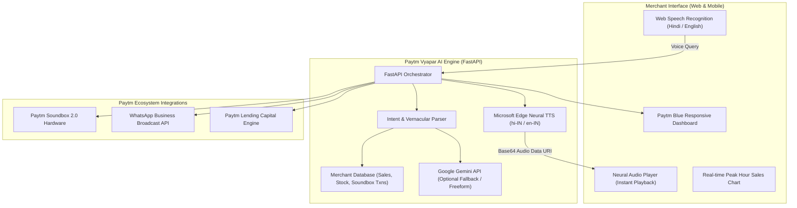

# 🚀 Paytm Vyapar AI (पेटीएम व्यापार एआई)
### *The Autonomous AI Business Partner for Every Paytm Merchant*
**Hackathon Track 1:** Merchant Growth AI  
**Target User:** 35+ Million Indian Kirana & Small Retail Merchants  

---

### 6. ?? DMart 3D Smart Racks (Cinematic Visual Retail Twin)
- **Hypermarket 3D Gondolas:** Simulates physical multi-tier supermarket retail racks with slotted uprights, overhead DMart aisle signs, and electronic shelf labels (ESL).
- **Vision AI Stock Twin:** Real-time visual depiction of stocked packages, phantom empty slots for depleted items, and glowing LED shelf edge strips (?? Healthy, ?? Low Buffer, ?? Critical <15%).
- **Multi-Business Retail Layouts:** Instant adaptation across 5 merchant trades:
  - *Kirana & Grocery:* Dairy Chiller, Grains & Atta, FMCG & Snacks, Spices & Cleaners.
  - *Pharmacy:* Cold Rx Antibiotics & Insulin, OTC Analgesics, Cough Syrups, First Aid & ORS.
  - *Cafe & Restaurant:* Espresso Bar & Syrups, Dairy Buffers, Bulk Dry Pantry, Commercial Seasonings.
  - *Apparel & Garments:* Festive Kurtis, Denim Jeans Cubbies, Cotton Shirts, Activewear Joggers.
  - *Mobile & Electronics:* Fast Chargers, 9D Tempered Glass Wall, Wireless Audio, Braided Cables & Power Banks.
- **Cinematic Visual Controls:**
  - ?? **Daylight Supermarket:** Crisp clean hypermarket lighting.
  - ?? **Cinematic Neon Chiller:** Atmospheric high-contrast studio lighting with neon shelf LEDs.
  - ?? **Critical Stock Heatmap:** Highlights empty shelves with radiant red warning halos.
  - ?? **Cinematic Drone Sweep:** Smooth 3D isometric camera dolly gliding across aisles.
- **1-Click ONDC Restock:** Instant shelf replenishment animation and Soundbox voice confirmation across 5 Indic languages (English, Telugu, Hindi, Tamil, Kannada)!

## 📌 Problem Statement & Why This Wins
Small shopkeepers in India love Paytm for its **Soundbox** and **UPI payments**, but they struggle with:
1. **Inventory Blindspots:** Fast-selling items (milk, edible oil) run out during evening peak hours without warning.
2. **Vernacular & Tech Barriers:** Merchants don't want to type complex queries on dashboards; they prefer talking in **Hindi / local languages**.
3. **Underleveraged Marketing:** Zero time to create festive discounts or WhatsApp marketing campaigns.
4. **Delayed Access to Working Capital:** High potential for micro-credit, but merchants don't know their loan eligibility.

**Paytm Vyapar AI** bridges this gap: It turns every Paytm Soundbox and Merchant app into an **AI-powered voice co-pilot** that acts like a smart business manager.

---

## ✨ Core Features & Demo Highlights

### 1. 🎙️ Vernacular Voice-First Co-pilot (पेटीएम आवाज़)
- **Speech-to-Speech in Hindi and Indian English** powered by Neural Speech Synthesis and Web Speech Recognition.
- Natural conversation tailored to Indian kirana semantics (*"आज की कुल बिक्री कितनी हुई?"*, *"अमूल दूध का स्टॉक कितना बचा है?"*).

### 2. ⚡ Live Paytm Soundbox 2.0 Integration
- Simulates real-time payment alerts (*"Paytm par 500 rupaye prapt hue"*) immediately paired with smart merchant contextual tips (*"Bhaiya, aaj ka target 80% pura ho gaya!"*).

### 3. 📦 Stock Depletion Radar & 1-Click PO Restock
- Automatically tracks inventory velocity and warns merchants before critical items run out.
- Generates a 1-tap WhatsApp Purchase Order directly to the local FMCG wholesaler.

### 4. 📢 1-Click Hyperlocal WhatsApp Marketing Generator
- Instantly drafts festive and weekend promotional broadcasts with emoji formatting and Paytm payment links.
- Direct integration to WhatsApp Web/Mobile with one click.

### 5. 💰 Instant Merchant Growth Credit Pre-Approval
- Evaluates real-time QR/Soundbox settlement consistency to show instant pre-approved loans (e.g. ₹2,50,000 at 1.15% monthly, auto-settled at ₹320/day via Soundbox).

---

## 🏗️ Architecture



---

## 🏃 How to Run the Prototype

### Prerequisites:
- Python 3.10+ (Already configured with `fastapi`, `uvicorn`, `edge-tts`)

### Quick Start:
Double-click `start.bat` or run:

```bash
cd paytm-merchant-growth-ai
python run.py
```

Then open your browser at:
👉 **`http://127.0.0.1:8000`**

---

## 🎤 4-Minute Winning Pitch & Demo Script

1. **Minute 0:00 - 0:45 (The Hook & Paytm Alignment):**
   > *"Paytm revolutionized Indian retail with the Soundbox. Today, we present Paytm Vyapar AI—taking merchants from payment collection to complete business growth."*
2. **Minute 0:45 - 1:30 (Live Voice Interaction):**
   > *Click the Mic button and ask in Hindi:*  
   > **"आज की कुल बिक्री और यूपीआई कलेक्शन कितना है?"**  
   > *The assistant speaks back in natural Hindi with the exact metrics.*
3. **Minute 1:30 - 2:30 (Inventory & Soundbox Simulation):**
   > *Click 'Simulate Payment (₹500)' $\rightarrow$ Listen to the iconic Soundbox chime + AI target update.*  
   > *Ask:* **"कौन सा सामान खत्म होने वाला है?"** $\rightarrow$ *Show the 1-click PO dispatch to the wholesaler.*
4. **Minute 2:30 - 3:30 (Growth & Marketing):**
   > *Ask:* **"दीवाली ऑफर का 10% डिस्काउंट वाला व्हाट्सएप मैसेज बनाओ"**  
   > *Show the preview and click 'Open in WhatsApp' to demonstrate instant marketing.*
5. **Minute 3:30 - 4:00 (Fintech & Monetization):**
   > *Show the Pre-Approved ₹2,50,000 Merchant Loan with Soundbox auto-deduction—explaining how this deepens Paytm's high-margin lending business.*
